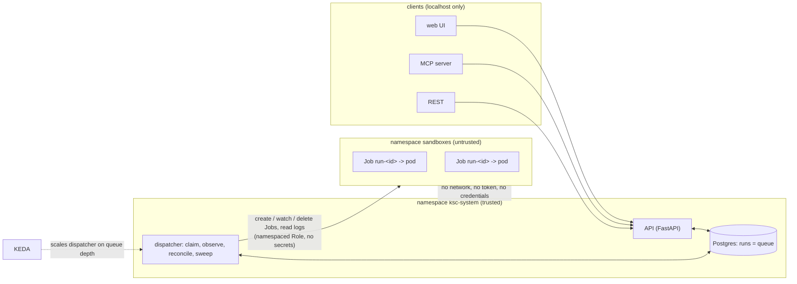

# k8s-sandbox-control-plane

[](https://github.com/manynames3/k8s-sandbox-control-plane/actions/workflows/ci.yml)

A small platform where an AI agent (over MCP or REST) or a person (over a web UI) submits untrusted code and it runs in an
isolated, short-lived Kubernetes sandbox that is provably cleaned up afterwards. **A small, self-hostable reference
implementation of the isolation and cleanup layers that hosted sandbox providers abstract away. Not a replacement for
them.** It is an independent portfolio project: every claim below can be checked against a test, a CI run, or a results file.

**Live replay site:** *not deployed yet.* It needs a Cloudflare token from the owner (`.github/workflows/showcase.yml` builds
and leak-checks it on every push and deploys once configured). It is a static page that plays back real recorded runs, shows
the measured results, and **cannot execute code**.

## 60-second local quickstart

Needs Docker (Colima or Docker Desktop), `kind`, `kubectl`, `helm`, `uv`, `jq`, Node 22. About 5 minutes the first time.

```bash
make up                                   # kind (1 control plane + 2 workers) + Calico + KEDA + chart + images
make verify-cluster                       # the cluster's guarantees, with positive controls
KEY=$(kubectl -n ksc-system exec deploy/ksc-api -- python -m api.keys create me)
kubectl -n ksc-system port-forward svc/ksc-api 8080:8080 &
curl -s -XPOST localhost:8080/v1/runs -H "Authorization: Bearer $KEY" -H 'Content-Type: application/json' \
     -d '{"language":"python3.12","code":"print(\"hello\")"}'            # 202, then GET /v1/runs/<id>
(cd web && npm ci && npm run dev)         # live UI on http://127.0.0.1:5173 (paste the key)
make test e2e attack chaos                # unit, end-to-end, hostile-code, kill-things suites
make down                                 # leaves nothing behind
```

The API is **never exposed**: localhost on kind, `kubectl port-forward` on a cluster. An MCP server (`mcp/ksc_mcp_server.py`)
and a transcript of a real agent session using it are in [docs/agent-transcript.md](docs/agent-transcript.md).

## Architecture



The sandbox never talks to the platform; results are collected from outside (exit code from container status, output from the
log API). The database holds intent, the cluster holds reality, and the dispatcher converges them ([ADR 6](docs/adr/0006-reconciling-controller.md)).

## How isolation works

Security is enforced **on the pod spec by the cluster**, not by scanning user code ([ADR 5](docs/adr/0005-cluster-enforced-security.md)).

- Every pod is built from one fixed template (`dispatcher/podspec.py`): non-root UID 10001, no privilege escalation, all
  capabilities dropped, `RuntimeDefault` seccomp, read-only root filesystem, a size-limited `emptyDir` at `/tmp` as the only
  writable path, no service-account token, no host namespaces or volumes, requests equal limits (500m CPU, 512Mi), PID limit 256.
- The `sandboxes` namespace enforces Pod Security `restricted`, a `ValidatingAdmissionPolicy` (read-only rootfs, no token, limits,
  only `configMap`/`emptyDir` volumes), a default-deny NetworkPolicy including DNS, a ResourceQuota (pod count = the concurrency cap)
  and a LimitRange, so the guarantees hold even if the dispatcher has a bug.
- Three timeout layers (wrapper kill at the timeout, Job `activeDeadlineSeconds`, sweeper) and four cleanup layers; the result is
  stored before anything is deleted.

## The attack suite

Each case submits real hostile code through the public API and asserts both the run outcome and the cluster state
(`make attack`, run in CI on every push). Positive controls make sure a denial is the policy, not a broken probe.

| Attempt | Must hold | Test |
|---|---|---|
| Outbound TCP to a public IP, DNS, the Kubernetes API, another pod, `169.254.169.254` | All fail; the run completes (loopback control succeeds) | [`test_network_is_fully_denied_but_run_completes`](tests/attack/test_attacks.py#L56) |
| Read the service-account token path | Does not exist | [`test_service_account_token_does_not_exist`](tests/attack/test_attacks.py#L93) |
| Write outside `/tmp` | Read-only filesystem (errno 30) | [`test_cannot_write_outside_tmp`](tests/attack/test_attacks.py#L111) |
| Fill `/tmp` past its limit | Evicted, reported as `failed/ephemeral_storage_exceeded`, node unaffected | [`test_filling_tmp_is_contained_and_reported`](tests/attack/test_attacks.py#L127) |
| Allocate memory past the limit | `oom_killed` | [`test_memory_past_the_limit_is_oom_killed`](tests/attack/test_attacks.py#L146) |
| Fork bomb | Forks stop at the PID limit; neighbouring runs still succeed | [`test_pid_limit_stops_forking_at_the_cap`](tests/attack/test_attacks.py#L152), [`test_fork_bomb_is_contained_and_neighbours_still_run`](tests/attack/test_attacks.py#L173) |
| Infinite loop | `timed_out` at about the timeout, not at the backstop | [`test_infinite_loop_times_out_at_about_the_timeout`](tests/attack/test_attacks.py#L198) |
| Unbounded output | Truncated with the flag set; dispatcher memory flat | [`test_unbounded_output_is_truncated_and_dispatcher_memory_stays_flat`](tests/attack/test_attacks.py#L210) |
| Find another concurrent run's code or files | Not found (positive control included) | [`test_cannot_find_another_concurrent_runs_code_or_files`](tests/attack/test_attacks.py#L229) |
| `mount`, `chroot`, raw socket, capabilities | Non-root, no capabilities, denied | [`test_no_capabilities_no_privilege_no_mount_chroot_or_raw_sockets`](tests/attack/test_attacks.py#L269) |
| Privileged, hostPath or writable-rootfs pod applied directly with `kubectl` | Rejected at admission | [`privileged`](tests/attack/test_attacks.py#L323), [`hostPath`](tests/attack/test_attacks.py#L329), [`policy`](tests/attack/test_attacks.py#L341) |
| Kill the dispatcher with 10 runs in flight | One terminal state each, none ran twice, `sandboxes` ends empty | [`test_killing_the_dispatcher_with_10_runs_in_flight`](tests/chaos/test_chaos.py#L102) |
| Interrupt the database | `/readyz` returns 503, then recovers | [`test_database_interruption_degrades_readiness_and_recovers`](tests/chaos/test_chaos.py#L136) |
| (AWS only, not run yet) pod reaches instance metadata | Cannot; a `hostNetwork` control can | [`test_eks_only`](tests/attack/test_eks_only.py#L56) |

Last full local run: 114 unit, 17 end-to-end, 17 attack (plus 1 EKS-only, skipped on kind) and 2 chaos tests; see the badge and
the [Actions history](https://github.com/manynames3/k8s-sandbox-control-plane/actions).

## Measured results

Generated from the committed results files by `bench/render_table.py`; nothing below is typed by hand. A benchmark is 200 runs
at each concurrency of a short CPU-bound script (`make bench`). "Client concurrency" is the number of runs the client keeps in
flight; the cluster runs at most the cap at once, so at 20 the queue wait is mostly waiting for a slot.

<!-- BENCH:START -->
**kind-on-mac**, measured 2026-11-16 at `96b686a`. Kubernetes v1.36.4, containerd://2.3.4, 2 workers, concurrency cap 4, VM 4 CPU / 8 GiB, Prometheus/Grafana running alongside. Workload: python3.12: sum of squares over 1.5M integers (~0.2 s CPU), 500m CPU / 512Mi limits. Source: [`bench/results/2026-11-16-kind-on-mac.json`](bench/results/2026-11-16-kind-on-mac.json).

| client concurrency | runs | succeeded | queue wait p50 / p95 / p99 (s) | schedule p50 / p95 / p99 (s) | end-to-end p50 / p95 / p99 (s) | throughput (runs/s) |
|---|---|---|---|---|---|---|
| 5 | 200 | 200 | 1.20 / 2.30 / 2.76 | 0.09 / 0.62 / 0.78 | 4.28 / 5.46 / 5.85 | 1.105 |
| 20 | 200 | 200 | 13.03 / 15.03 / 15.56 | 0.28 / 0.79 / 0.89 | 16.00 / 18.34 / 18.81 | 1.187 |

Cold start (image pulled versus pre-pulled): not measured here. kind loads images into nodes; pulled-versus-pre-pulled needs a registry (EKS session)

SLO sample from this benchmark: 400 of 400 runs finished without `infra_error` (100.00%).
<!-- BENCH:END -->

**EKS:** no results yet. The AWS session has never been run (it spends money and is started by the owner, see [docs/AWS.md](docs/AWS.md)).

## SLO

**99% of runs reach a terminal state without `infra_error`** (`infra_error` is the platform's fault; a user's code failing does
not count). Measured so far: see "SLO sample" in the results above (400 benchmark runs, one environment). That is a small sample on
a laptop cluster, not an uptime claim. The dashboard shows the live ratio; the alert fires above 1% over 15 minutes
([runbook](docs/RUNBOOK.md)).

## Cost model

Idle cost target: **under $0.10 per month, all-in**; nothing runs in AWS between sessions (no NAT gateway, load balancer, RDS,
KMS key or always-on cluster, each guarded in CI). One EKS session is estimated at about $0.25 per hour (about $0.49 for the
default two hours; prices are partly **unverified** constants). The measured session cost is **not available** because no
session has been run. Details and every cost trap: [docs/COST.md](docs/COST.md).

## Design decisions

[Postgres is the queue](docs/adr/0001-postgres-as-queue.md) ·
[works through a transaction-mode pooler](docs/adr/0002-transaction-pooler-compat.md) ·
[Neon, not RDS](docs/adr/0003-neon-not-rds.md) ·
[the sandbox never talks to the platform](docs/adr/0004-sandbox-never-talks-to-platform.md) ·
[cluster-enforced security](docs/adr/0005-cluster-enforced-security.md) ·
[reconciling controller](docs/adr/0006-reconciling-controller.md) ·
[topology spread](docs/adr/0007-topology-spread.md) ·
[static UI, two data sources](docs/adr/0008-static-ui-two-sources.md) ·
[ephemeral EKS](docs/adr/0009-ephemeral-eks.md) ·
[GitHub OIDC](docs/adr/0010-github-oidc.md) ·
[multi-arch images on GHCR](docs/adr/0011-ghcr-multiarch.md) ·
[honest scaling](docs/adr/0012-honest-scaling.md) ·
[why not agent-sandbox](docs/adr/0013-why-not-agent-sandbox.md).

**Why not `kubernetes-sigs/agent-sandbox`?** It manages long-lived, stateful, singleton sandboxes (an agent's persistent
workspace); this project runs one-shot jobs (submit, run, collect, delete) and needs the queue, concurrency cap, timeout layers,
result capture and cleanup reconciliation around them, none of which that project describes. This project also exists to build
and attack the isolation and cleanup layers directly. For a long-lived agent workspace, use agent-sandbox. More in the ADR.

Also: [threat model](docs/THREAT_MODEL.md) · [runbook](docs/RUNBOOK.md) · [AWS session](docs/AWS.md) · [demo script](docs/demo.md) ·
[handoff (scope and decisions)](docs/HANDOFF.md) · [progress log with every finding](PROGRESS.md).

## Known limitations

- **Shared kernel (runc).** A kernel or runtime exploit is an escape; kernel exploits, side channels and a compromised
  dispatcher are explicitly not defended ([threat model](docs/THREAT_MODEL.md)). gVisor is only an untested stretch goal.
- **Single tenant.** One database, shared nodes, no per-tenant isolation or fairness between keys. Per-key limits (600 submissions per minute,
  200 runs in flight, 8 event streams) are enforced with HTTP 429; a key can still fill its own share of the queue.
- **kind is not production.** Measured numbers are from a laptop cluster (4 CPU / 8 GiB VM, 2 workers, cap 4), with the Docker VM's
  disk on a USB drive.
- **Nothing in AWS has ever run.** The Terraform and workflows pass `validate`, tflint, Checkov, trivy and actionlint, but no
  `plan` or `apply` has been executed. The IAM policy may be missing an action; the VPC CNI, Neon-through-PgBouncer, the PID
  limit on EKS and gVisor are all unverified ([docs/AWS.md](docs/AWS.md)).
- **Public-subnet nodes** (no NAT) and a public API endpoint limited to one address are cost trade-offs, with no KMS envelope
  encryption; each accepted trivy finding is justified in `.trivyignore.yaml`.
- **Observation is a poll, not a watch.** Log streaming and status have about half a second of latency.
- **Cold start (pulled vs pre-pulled image) was not measured**; kind loads images, so it needs the AWS session.
- **The Cloudflare deploy was never run** (needs the owner's token); the replay site's only tested path is the local build.
- **The UI has no browser-automation suite**; it was exercised by hand in a browser.
- **An independent review found and I fixed several real defects** (a NUL byte in output could wedge a run; a vanished Job could cause a
  re-run; unenforced per-key limits; an IAM escalation path in the CI role). Findings I accepted without fixing are listed in the
  [threat model](docs/THREAT_MODEL.md#independent-review-2026-11-16). Kubernetes can still rarely start a Job's pod twice.
- The dispatcher's RBAC is slightly broader than the original brief (`list` configmaps, `delete` pods) so the sweeper can find
  and remove orphans.

## Status

An independent portfolio project. The demo code and data are fictional. **Not production-ready, not enterprise-tested, no claim of
SOC 2, uptime, customers or scale.** Do not expose the API to the internet: it executes arbitrary code by design.
